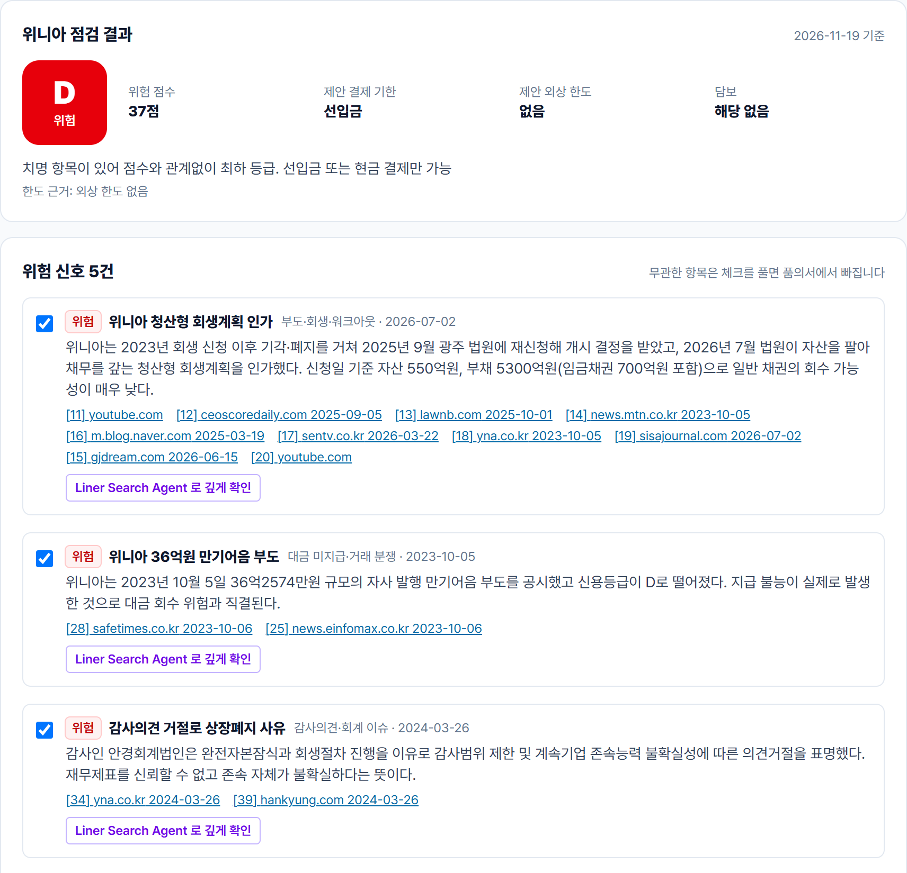

# 거래처 실사 에이전트

새 거래처와 외상 거래를 트기 전에 재무 담당자가 하는 조사를 대신 해 주는 에이전트입니다.
회사명을 넣으면 공시 재무 수치와 최근 악재를 모아 위험 등급과 거래 조건(결제 기한, 외상 한도, 담보) 초안을 내고, 담당자가 고쳐서 승인하면 품의서 초안까지 씁니다.

라이너 .EXE-THON 제출작입니다. 기획서: [docs/기획서.pdf](docs/기획서.pdf)



## 실행 방법

Node.js 20.9 이상이 필요합니다.

```bash
npm install
cp .env.example .env.local   # LINER_API_KEY 값을 채웁니다
npm run dev
```

브라우저에서 http://localhost:3000 을 엽니다.

화면이 계속 새로고침되는 등 개발 서버가 불안정하면 `npm run build && npm start` 로 실행해도 됩니다(같은 주소, 포트 3000).

한 번 점검하는 데 30~40초, 위험 신호 한 건을 깊게 확인하는 데 30초~1분쯤 걸립니다.

환경 변수는 `LINER_API_KEY` 하나만 있으면 됩니다. 키는 코드에 적혀 있지 않고 환경 변수로만 읽습니다.

| 변수 | 필수 | 설명 |
|---|---|---|
| `LINER_API_KEY` | 예 | Liner Platform API 키 |
| `DART_API_KEY` | 아니오 | OpenDART 키. 넣으면 저장된 15개사 말고 다른 상장사의 공시도 바로 조회합니다 |
| `LINER_MODEL` | 아니오 | 모델 Router 이름. 기본값 `liner-claude-router` |

### 바로 해 볼 수 있는 회사

공시 재무 자료를 저장소에 넣어 둔 회사입니다. DART 키 없이도 재무 지표가 나옵니다.

| 예상 결과 | 회사 |
|---|---|
| 양호 | 삼성전자, 농심, 오뚜기, 삼양식품, 아모레퍼시픽, LG생활건강, 에이피알, 오아시스, 한샘 |
| 주의 | 컬리, 이마트, 롯데케미칼, 태영건설 |
| 위험 | CJ CGV, 위니아(완전자본잠식, 감사의견 거절) |

위 표는 재무 수치만으로 본 결과입니다. 실제 등급은 검색에서 나온 위험 신호가 더해져 달라질 수 있습니다.
목록에 없는 회사도 입력할 수 있습니다. 그때는 재무 수치 없이 검색 결과만으로 점검하고, 재무를 확인하지 못했다는 점이 점수와 화면에 반영됩니다.

## 동작 순서

1. **공시 재무 수치**: 사업보고서에서 부채비율, 유동비율, 이자보상배율, 매출채권 회전일, 매출 증감률, 영업이익률을 계산하고 자본잠식, 연속 적자, 감사의견을 확인합니다.
2. **악재 검색**: 부도·회생, 신용등급, 감사의견, 소송·가압류, 제재·체납, 경영진, 대금 미지급의 7개 주제를 동시에 검색합니다.
3. **위험 신호 가려내기**: 검색 결과에서 이 회사의 대금 회수에 영향을 주는 사건만 골라 심각도를 매깁니다.
4. **등급과 거래 조건**: 지표와 신호에 점수를 매겨 A~D 등급, 결제 기한, 외상 한도, 담보 조건을 제안합니다. 이 단계는 모델이 아니라 정해진 규칙으로 계산합니다.
5. **담당자 검토**: 무관한 신호를 빼고 조건을 고칩니다. 의심스러운 신호는 한 건씩 깊게 확인할 수 있습니다.
6. **품의서 초안**: 검토한 내용으로 품의서를 씁니다.

## Liner API를 사용한 기능

Liner를 부르는 코드는 `lib/liner.ts` 한 파일에 있습니다.

| 기능 | Liner API | 쓰이는 곳 |
|---|---|---|
| 금융·법률 전문 검색 | 검색 MCP `search_finance`, `search_legal` (`/api/v1/mcp`) | 2단계. 부도·신용등급·감사의견과 소송·제재 주제 |
| 웹 검색 | `POST /api/v1/tools/search/web` | 2단계. 경영진·대금 미지급 주제, 전문 검색이 비었을 때의 대체 검색 |
| 위험 신호 분류 | 모델 Router `POST /api/v1/chat/completions` (JSON 스키마 출력) | 3단계 |
| 신호 심층 확인 | Search Agent `POST /api/v1/agents/search` (스트리밍) | 5단계 "깊게 확인" 버튼 |
| 품의서 작성 | 모델 Router `POST /api/v1/chat/completions` | 6단계 |

화면의 진행 상황과 "Liner API 호출 기록"에서 어느 단계가 어떤 API를 불렀는지 볼 수 있습니다.

## 믿을 수 있게 만든 장치

- 모든 위험 신호에는 출처 링크와 날짜가 붙습니다. 모델이 근거 번호를 대지 못한 신호는 버립니다.
- 검색이나 분류가 실패하면 "위험 없음"으로 처리하지 않고 등급을 **판정 보류**로 둡니다.
- 검색 결과가 없던 주제는 "확인하지 못한 사항"으로 따로 보여 줍니다.
- 등급과 한도는 규칙으로 계산하므로 같은 입력에는 같은 결과가 나오고, 계산 근거가 화면에 표시됩니다.
- 대체 계정으로 계산한 지표(이자 지급액, 매출채권 및 기타채권 합계)는 그 사실을 표시합니다.
- 최종 결정은 담당자가 합니다. 제안과 다르게 정하면 그 이유가 품의서에 남습니다.

## 다른 조직에서 쓰려면

판단 기준은 `config/rules.json` 한 파일에 있습니다. 코드를 고치지 않고 아래를 바꿀 수 있습니다.

- 지표별 주의·위험 기준값
- 항목별 점수와 등급 구간
- 등급별 결제 기한, 한도 산식(월 거래액의 몇 개월분, 상대 회사 자기자본의 몇 %), 담보 조건
- 검색 주제와 검색어

검색 주제만 바꾸면 구매팀의 공급사 점검, 영업팀의 신규 고객 심사, 법무팀의 계약 전 확인에도 쓸 수 있습니다.

## 폴더 구성

```
app/page.tsx            화면
app/api/diligence       점검 실행(진행 상황을 한 줄씩 흘려보냄)
app/api/deepcheck       Search Agent 심층 확인
app/api/memo            품의서 작성
lib/liner.ts            Liner API 연결부
lib/dart.ts             공시 수치 추출
lib/metrics.ts          지표, 경고, 등급·한도 계산
lib/diligence.ts        전체 흐름
config/rules.json       판단 기준
data/financials         저장해 둔 공시 재무 자료(15개사)
data/corp-codes.json    상장사 고유번호
scripts/seed.ts         공시 자료를 받아 data/ 에 저장하는 스크립트
```

## 데이터

- 재무 수치와 감사의견: 금융감독원 전자공시(OpenDART)의 2025년 사업보고서. 누구나 볼 수 있는 공개 자료입니다.
- 악재: Liner 검색 결과. 실행할 때마다 새로 가져옵니다.
- 회사 내부 자료, 고객 정보, 개인정보는 쓰지 않습니다. 화면에 넣는 월 거래액과 결제 기한은 시연용 가상 값입니다.

## 기존 결과물과 새로 만든 부분

이 저장소의 코드는 모두 대회 개발 기간(2026-11-12 ~ 11-25)에 새로 만들었습니다. 기존 결과물을 가져온 부분은 없습니다.

## 한계

- 공시가 없는 비상장 소기업은 재무 수치를 확인하지 못합니다.
- 이름이 같은 회사가 있으면 검색 결과가 섞일 수 있습니다. 분류 단계에서 걸러 내지만 담당자가 출처를 확인해야 합니다.
- 이 도구는 초안을 만듭니다. 신용 판단의 책임은 담당자에게 있습니다.
